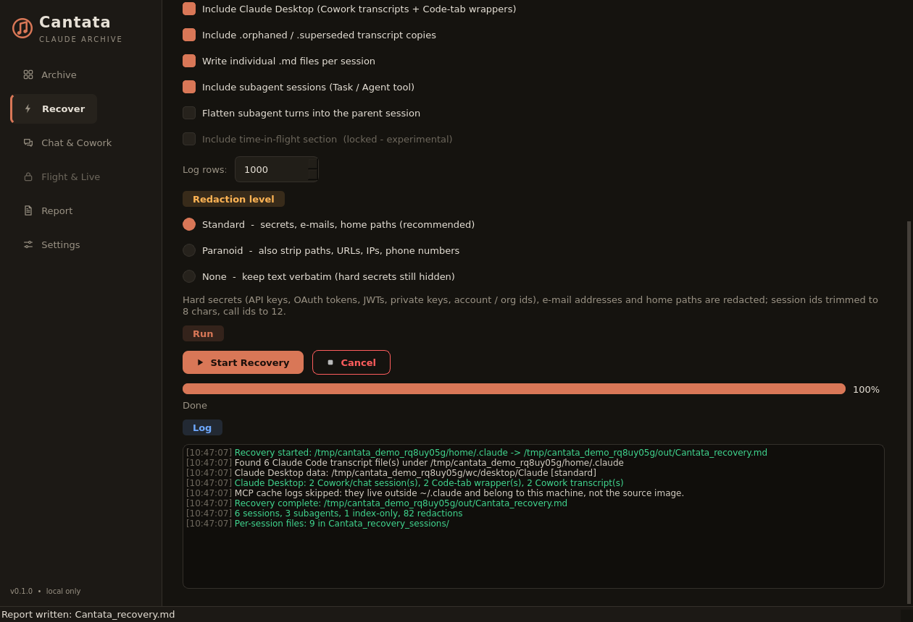
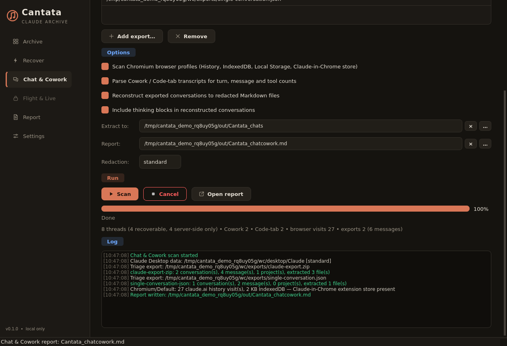
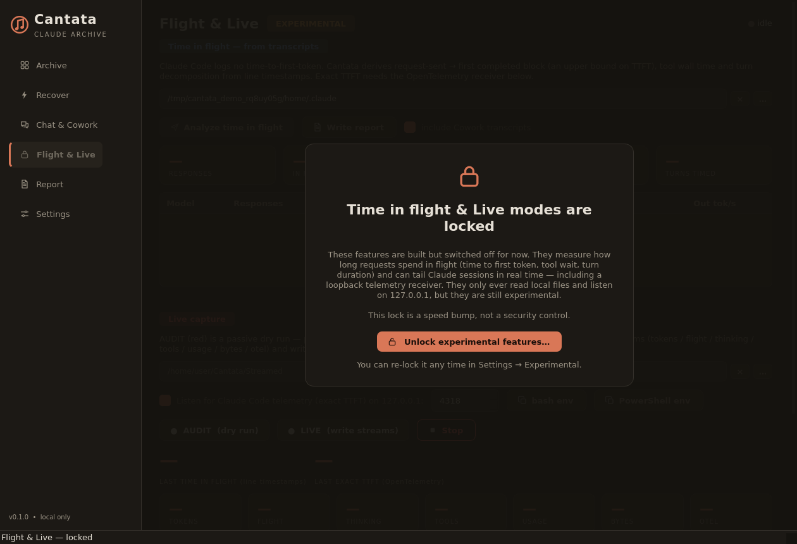
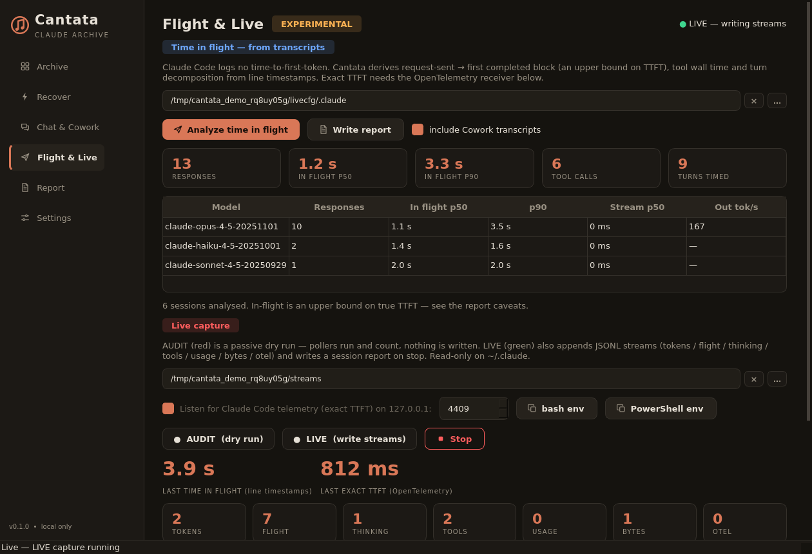

# Cantata

**Local-only archive & forensic recovery for Claude** 

Cantata reads what **Claude Code**, **Claude Desktop** (Cowork + Code tab) and **claude.ai** leave on *your own machine*,
reconstructs every conversation, redacts PII and secrets, and writes one navigable Markdown report plus one file per session.
Nothing is uploaded, Claude's files are never modified (Cantata only writes its own reports and `~/.cantata/state.json`), and the only
socket it can ever open is an optional loopback listener in a locked experimental mode.

> **Why now:** Claude Code silently **deletes transcripts older than `cleanupPeriodDays` (default 30 days)**. The Archive page shows
> how many of yours are about to go.

<p align="center">
  
  
</p>
<p align="center">
  
  
</p>

*(Screenshots are rendered offscreen from synthetic data by `tools/ui_snapshot.py --demo`. Sample outputs:
[recovery report](docs/sample_recovery_report.md) · [Chat & Cowork report](docs/sample_chatcowork_report.md) ·
[time in flight](docs/sample_time_in_flight.md).)*

---

## What it reads

| Source                                        | Where                                                                                                                                                                                                             | What Cantata gets                                                                                                     |
| --------------------------------------------- | ----------------------------------------------------------------------------------------------------------------------------------------------------------------------------------------------------------------- | --------------------------------------------------------------------------------------------------------------------- |
| **Claude Code** (CLI, VS Code/JetBrains, SDK) | `~/.claude/projects/**/*.jsonl` (+ `.orphaned-*`, `.superseded-*`, `subagents/`)                                                                                                                                  | every turn, tool call + result, thinking, subagent, compaction, token usage                                           |
| Claude Code state                             | `history.jsonl`, `stats-cache.json`, `sessions-index.json`, `settings*.json`, `~/.claude.json`, `CLAUDE.md`, auto-memory, plans, tasks/todos, file-history, IDE locks, plugins, telemetry queue, debug + MCP logs | settings, hooks, MCP servers (key names only), memory, prompt history, **index-only sessions** (remembered but swept) |
| **Claude Desktop → Cowork**                   | `<Claude app-data>/local-agent-mode-sessions/…` (classic, MSIX-virtualised and 3P roots)                                                                                                                          | full Cowork transcripts, subagents, `audit.jsonl` cost/turn summary, memory notes                                     |
| **Claude Desktop → Code tab**                 | `…/claude-code-sessions/*/local_*.json`                                                                                                                                                                           | wrapper ⟷ `~/.claude/projects` transcript linking; orphaned wrappers flagged                                          |
| **claude.ai** (Chat)                          | browser `History`, IndexedDB, Local Storage, **Claude-in-Chrome** store                                                                                                                                           | which chats you opened and when; size of the offline cache; plaintext-token store *flagged, never read*               |
| **Export archives**                           | `Settings → Privacy → Export data` zip                                                                                                                                                                            | triage (counts, sha256, PII markers) **and full reconstruction** to redacted Markdown                                 |

Everything is research-backed: see **[docs/CLAUDE_STORAGE.md](docs/CLAUDE_STORAGE.md)** for the on-disk formats, the confidence
level of each claim and the sources.

## Quick start

```bash
# Windows:   install.bat   then   launch.bat            (launch_debug.bat shows the console)
# Linux/mac: python -m venv .venv && . .venv/bin/activate && pip install -r requirements.txt && python run.py
python run.py                                   # GUI
python run.py cli recover                       # headless: ./Cantata_recovery.md + ./Cantata_recovery_sessions/
```

The engine and the CLI are **pure standard library** (Python ≥ 3.10); only the GUI needs PyQt6.

## GUI

| Page                 | What it does                                                                                                                                                                                                                             |
| -------------------- | ---------------------------------------------------------------------------------------------------------------------------------------------------------------------------------------------------------------------------------------- |
| **Archive**          | auto-detects `~/.claude` (honours `CLAUDE_CONFIG_DIR`) and Claude Desktop; sessions / subagents / orphaned / projects / prompts / size / date range; **retention clock + "expiring within a week" banner**; version detection; inventory |
| **Recover**          | content toggles, redaction level, progress, live log → report + per-session files                                                                                                                                                        |
| **Chat & Cowork**    | Desktop catalog, browser traces, export triage + reconstruction → report (+ `Cantata_chats/`)                                                                                                                                            |
| **Flight & Live** 🔒 | *experimental, locked by default* — see below                                                                                                                                                                                            |
| **Report**           | preview, open, reveal, copy path                                                                                                                                                                                                         |
| **Settings**         | defaults, accent colour, **Experimental gate**, about                                                                                                                                                                                    |

### Analysing a copied folder (forensic image)

Point **Source** at the copy. Cantata then deliberately does **not** fold in anything from *this* machine: no
auto-detected Claude Desktop, no `claude-cli-nodejs` MCP logs, no `~/.claude.json` fallback (only `<source>/.claude.json` or the
file beside it). To include a copied Desktop app-data folder, set the **Desktop** field (CLI: `--desktop-dir`). On Windows,
Desktop's MSIX data path plus a Cowork session folder can pass 260 characters — Cantata opens such transcripts with the `\\?\` prefix
and reports anything it still cannot read in the report's **Warnings** instead of silently dropping it.

## CLI

```text
python run.py cli recover    -s ~/.claude -o report.md -l standard|paranoid|none
                             [--no-transcripts --no-app-state --no-tokens --no-tools --no-thinking --no-logs
                              --no-desktop --no-orphaned --no-per-sessions --no-subagents --flatten-subagents
                              --desktop-dir DIR --log-limit N --scan-only -q]
python run.py cli audit      [--json] [--desktop]                 # tokens / stop reasons / tools / stats-cache cross-check
python run.py cli chatcowork -e export.zip [--extract chats/] [--desktop-dir DIR] [--no-browser]
python run.py cli gate       --status | --unlock | --lock
python run.py cli flight     [--json] [-o flight.md] [--otel-dir Streamed]     # 🔒 gated
python run.py cli capture    [--audit] [--otlp-port 4318] [--duration S] [--print-env]   # 🔒 gated
```

Exit codes: `0` ok · `2` bad source · `3` gated and locked · `130` cancelled.

## Redaction

|                                                                                                                                                                                                                                                     | standard *(default)* | paranoid     | none         |
| --------------------------------------------------------------------------------------------------------------------------------------------------------------------------------------------------------------------------------------------------- | -------------------- | ------------ | ------------ |
| API keys (Anthropic `sk-ant-…`, OpenAI, GitHub, AWS, Google, Slack, Stripe, npm, HF), OAuth access/refresh tokens, JWTs, `Bearer` tokens, private keys, `KEY=value` secrets, URL credentials, `.credentials.json` blobs, account / org / device ids | **redacted**         | **redacted** | **redacted** |
| e-mail addresses (`noreply@anthropic.com` kept)                                                                                                                                                                                                     | redacted             | redacted     | kept         |
| home directories → `~`, other users' home names                                                                                                                                                                                                     | redacted             | redacted     | kept         |
| every absolute path → `[PATH]/file`, URLs → `[URL:host]`, IPv4 / MAC / phone, UUIDs → 4 chars                                                                                                                                                       | kept                 | redacted     | kept         |
| session ids / tool-call ids shown as                                                                                                                                                                                                                | 8 / 12 chars         | 4 / 6 chars  | full         |

**Hard secrets are hidden at every level, including `none`.** Credentials files, IDE lock tokens, MCP `env` / headers and
`audit.jsonl` keys are never read out at all — only their presence, key *names* and expiry.

## Time in flight & Live modes — built, locked for now

Two features are implemented and tested but hidden behind a **deliberately weak gate**:

* **Time in flight** — Claude Code's transcripts have **no time-to-first-token field** (Codex's do). Cantata derives, per API
  response, *request-sent → first completed block* (an **upper bound** on TTFT), *stream* time and tokens/s; tool wall time
  (`tool_use` → `tool_result`, including your permission wait); and a per-turn split into model / tools / other, next to the
  app-reported `turn_duration`, `durationMs`, Cowork `duration_api_ms` and `~/.claude.json` `lastAPIDuration`.

* **Live** — **AUDIT** (red dot, dry run: counts, writes nothing) and **LIVE** (green dot: appends JSONL streams
  `tokens / flight / thinking / tools / usage / bytes / otel` and writes a session report). It tails transcripts and, optionally,
  runs a **loopback-only OTLP/HTTP-JSON receiver** so Claude Code's own `claude_code.llm_request` spans deliver the **exact
  `ttft_ms`**:

  ```bash
  python run.py cli capture --experimental --otlp-port 4318 --print-env    # prints the env for bash / --shell powershell
  ```

**The gate is a speed bump, not security.** It is open if *any* of: the Settings → Experimental checkbox / the lock overlay's
Unlock button (persisted in `~/.cantata/state.json`), `python run.py cli gate --unlock`, `CANTATA_EXPERIMENTAL=1`, or
`--experimental` on a gated CLI command. Locked means: the Flight & Live page sits under a lock overlay, its sidebar entry shows a
lock, Recover's "time-in-flight section" is disabled, `flight` / `capture` / `recover --flight` exit with code 3, and **the default
reports contain no latency columns at all**.

## Output

```
Archive/                         (next to the app; Settings can change it)
  Cantata_recovery.md            combined report: overview, versions, retention & index-only sessions, sessions, projects,
                                 usage, application state, Desktop, logs, warnings, full transcripts
  Cantata_recovery_sessions/     01_<slug>.md, 02_<slug>.md …   (slug ≤ 100 chars, name ≤ 120: Windows MAX_PATH-safe)
  Cantata_chatcowork.md          Chat & Cowork report
  Cantata_chats/                 redacted per-conversation Markdown rebuilt from export zips
Streamed/                        Live-mode streams + session reports (only when unlocked)
```

Archives over ~200 MB of transcripts switch the combined report to *link* to the per-session files instead of embedding them.

> **Live-mode streams are raw local captures** (tool names, project folder names, 300-character thinking snippets with hard secrets
> scrubbed, telemetry attributes minus prompts / e-mail / account ids). Only the Markdown reports go through the redaction levels —
> treat `Streamed/` as sensitive. UI preferences and the gate live in `~/.cantata/state.json` (override with `CANTATA_HOME`).

## Layout

```
run.py                     GUI launcher (single-instance lock) / `cli` dispatcher
cantata/core/              pure stdlib
  paths.py                 per-OS locations + exact project-folder encoder (UTF-16 units, 200-char hash suffix)
  scanner.py  transcripts.py  stores.py  configs.py  desktop.py      discovery, parser, state readers
  redaction.py  recovery.py  report.py  audit.py                     redact, orchestrate, render, audit
  webchat.py  webchat_report.py                                      Chat & Cowork (Desktop, browser, exports)
  flight.py  capture.py  gate.py                                     time in flight, Live engine + OTLP receiver, soft gate
cantata/ui/                PyQt6 pages, widgets, workers, theme
tools/                     make_fixture.py, make_webchat_fixture.py, ui_snapshot.py
tests/                     core · chat & cowork · flight/live/gate · GUI (offscreen)
docs/CLAUDE_STORAGE.md     the research
```

## Tests

```bash
pip install -r requirements-dev.txt
python -m pytest            # 142 tests, ~10 s, no display needed (Qt runs offscreen)
python tools/make_fixture.py /tmp/fake_home && python run.py cli recover -s /tmp/fake_home/.claude -o /tmp/r.md
```

Fixtures are **synthetic** (planted secrets, PII, a corrupt line, an aged-out session, subagents in both layouts, compaction, an
orphaned copy, a Cowork tree, a real Chromium `History` SQLite, an export zip). The suite proves that no planted secret reaches
any report at any level, tokens are not double-counted across the multi-line responses, timings match known values, the OTLP
receiver refuses non-loopback binds / protobuf, History is never opened in place, and the GUI gate behaves.

## Verification status — please read

* Formats are taken from Anthropic's docs, binary-derived reports and community reverse-engineering (tagged ✅ / 🔎 / ❓ in the
  research doc). **Claude's transcript schema is undocumented and changes between releases**; the parser counts unknown line
  types and surfaces them in the report's Warnings rather than failing.
* Built and tested on Linux / Python 3.13 against the synthetic fixtures **only** — not against a real Claude install, and the
  Windows-specific paths (MSIX-virtualised Desktop dir, long-path handling, NIC byte counters) and macOS Keychain-only credentials
  are implemented from documentation but **unverified on those platforms**.
* The OTLP field names (`ttft_ms`, `duration_ms`, …) come from Anthropic's monitoring docs; the receiver was tested with
  hand-built payloads, not a live Claude Code export.
* Claude Desktop's Cowork `audit.jsonl` HMAC chain is **not verified** (the key is keychain-encrypted).

## Limitations

Claude.ai **Chat bodies are server-side** — without an export there is nothing local to recover beyond history/titles.
IndexedDB / Local Storage are Snappy-compressed LevelDB and are sized, not decoded. Encrypted `thinking` blocks are noted, not
recoverable. Cantata cannot bring back transcripts Claude Code already deleted; run it *before* the sweep.

"Claude" and "Anthropic" are trademarks of Anthropic, PBC. Cantata is an independent tool and is not affiliated with
or endorsed by Anthropic.

## Licence

MIT. See `LICENSE` 
